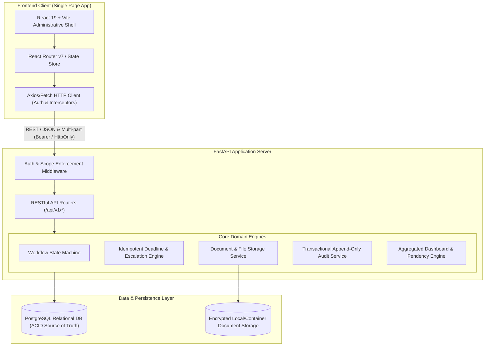

# SIH26262 System Architecture Specification

---

## 1. Architectural Overview & Component Topology
SIH26262 is constructed as a secure, high-cohesion, low-coupling **Modular Monolith** designed for high throughput, predictable latency, and zero distributed failure cascades.



---

## 2. Layer Responsibilities & Isolation

### A. Frontend Layer (React + Vite)
- Accessible, state-driven user interface consuming standard JSON REST APIs.
- Zero business logic duplication: states, permitted transitions, and error messages are dictated by server-side rules.
- Localized date formatting converting UTC database timestamps to Indian Standard Time (IST).

### B. API & Security Layer (FastAPI)
- **Authentication**: JWT token verification / Session resolution with sub-millisecond overhead.
- **Authorization**: Granular Scope Guard enforcing:
  1. Role permissions (e.g. only `REGIONAL_OFFICER` can execute deficiency returns).
  2. Institutional tenancy (e.g. `user.institution_id == application.institution_id`).
  3. Regional boundaries (e.g. `user.region_id == application.institution.region_id`).

### C. Domain Engines
1. **Workflow Engine**: Manages versioned stage definitions, checks preconditions (e.g., all mandatory documents uploaded), executes atomic transitions, and calculates stage deadlines.
2. **SLA & Escalation Engine**: Traverses active applications, scheduled EVC inspections, pending undertakings, and expiring documents. Evaluates deadlines against warning windows and escalation policies. Employs `deduplication_key` to ensure idempotent notification generation.
3. **Document Service**: Validates MIME types, checks magic numbers, generates random UUID storage filenames, prevents directory traversal, and enforces authenticated streaming.
4. **Audit Service**: Guarantees atomic insertion of audit events in the same transaction as state changes.

---

## 3. Data & Storage Strategy
- **Relational DB**: PostgreSQL 16+ as primary ACID store.
- **Document Store**: Persistent storage volume (`/app/document_storage`) segregated from web roots. Files stored with random UUID filenames; original file names and MIME types maintained strictly within PostgreSQL `documents` table.

---

## 4. Background SLA Processing Architecture
- Background SLA processing is decoupled into an idempotent service routine:
  ```python
  def evaluate_deadlines(db: Session, now: datetime) -> List[Notification]:
      # Evaluates stage deadlines, EVC visits, undertakings, and lease expiries
      # Calculates escalation level (1: Warning, 2: Overdue, 3: Critical)
      # Commits notifications with unique deduplication_key
  ```
- Can be invoked:
  1. Periodically via a single-instance lightweight in-process scheduler (e.g. `APScheduler`).
  2. On-demand by authorized administrative trigger (`POST /api/v1/alerts/check`).
- Scaling guarantee: Because notification creation uses an idempotent database constraint on `deduplication_key`, multiple concurrent workers will not generate duplicate alerts.


## AI document review and regulatory retrieval (implementation note)

The backend exposes `/api/v1/ai` endpoints for advisory PDF evaluation and a curated regulatory knowledge base. PDF extraction is bounded by file size and page count. Scanned-page OCR is optional and uses Tesseract when installed. Evaluation reports are stored as `DocumentEvaluation` rows, associated with the document, institution, application (if present), evaluator, content SHA-256 and engine mode.

Regulatory PDFs indexed by a system administrator are split into page-aware `RegulatoryChunk` records. When a configured Ollama embedding model is available, source chunks receive local embeddings and retrieval uses cosine similarity over stored JSON vectors; otherwise the service falls back to lexical ranking. Ollama can optionally generate answers from retrieved passages. When Ollama is unavailable, the API explicitly returns retrieval-only evidence and does not claim a generated answer. For larger corpora, migrate vector storage/search to PostgreSQL `pgvector`; the current prototype computes cosine similarity in application code.

Security boundary: institution uploads are not automatically indexed as shared policy sources. Document evaluation reuses existing document and regional authorization checks. Knowledge-base upload/deactivation is system-admin-only. AI reports are advisory and do not alter workflow or verification status.
