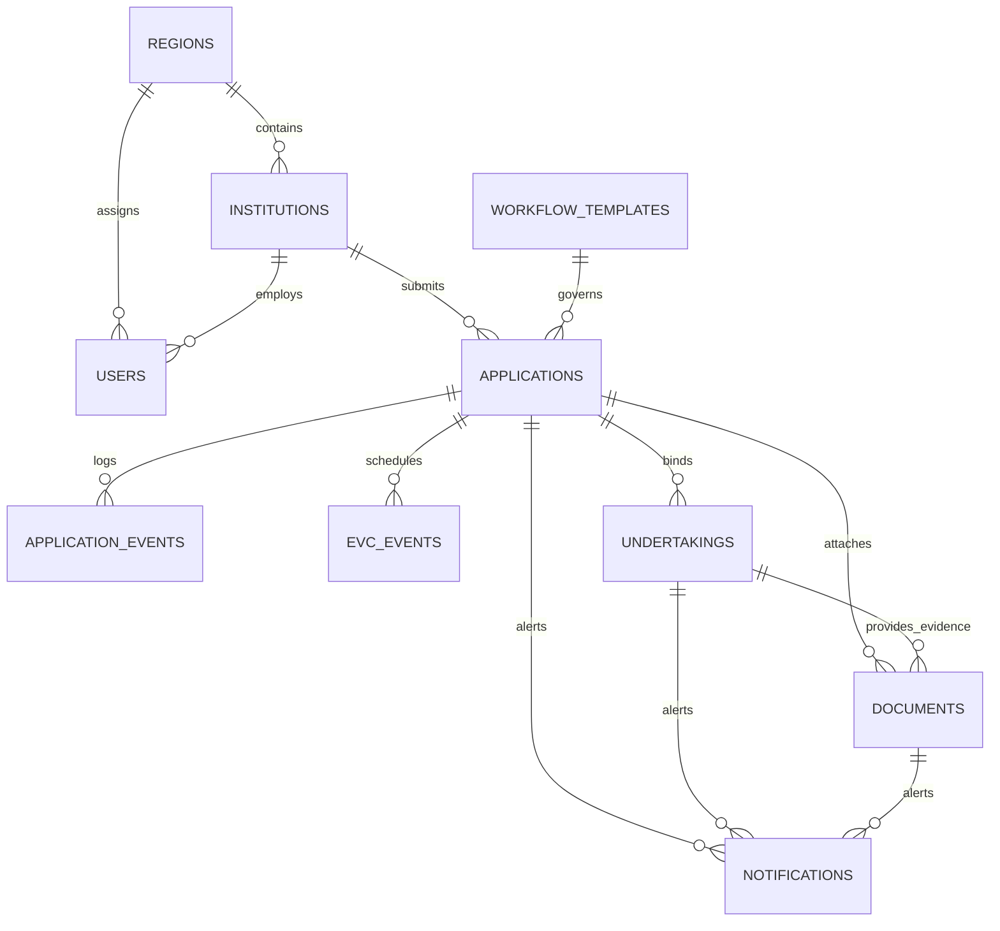

# SIH26262 Database and API Specification

---

## 1. Database Schema & Relational Model

### Table Definitions & Constraints

#### 1. `regions`
- `id` (VARCHAR(36), PK)
- `code` (VARCHAR(20), UNIQUE, NOT NULL) — e.g. `NORTHERN`, `WESTERN`, `SOUTHERN`
- `name` (VARCHAR(100), NOT NULL)
- `is_active` (BOOLEAN, DEFAULT TRUE)

#### 2. `institutions`
- `id` (VARCHAR(36), PK)
- `institution_code` (VARCHAR(50), UNIQUE, NOT NULL) — e.g. `AICTE-1-4920191`
- `name` (VARCHAR(255), NOT NULL)
- `region_id` (VARCHAR(36), FK -> regions.id, NOT NULL)
- `address` (TEXT)
- `contact_email` (VARCHAR(150), NOT NULL)
- `created_at` (TIMESTAMPTZ, DEFAULT NOW())

#### 3. `users`
- `id` (VARCHAR(36), PK)
- `email` (VARCHAR(150), UNIQUE, NOT NULL)
- `password_hash` (VARCHAR(255), NOT NULL)
- `display_name` (VARCHAR(150), NOT NULL)
- `role` (VARCHAR(50), NOT NULL) — `INSTITUTION_USER`, `REGIONAL_OFFICER`, `BUREAU_OFFICER`, `EVC_MEMBER`, `SYSTEM_ADMIN`
- `region_id` (VARCHAR(36), FK -> regions.id, NULLABLE)
- `institution_id` (VARCHAR(36), FK -> institutions.id, NULLABLE)
- `is_active` (BOOLEAN, DEFAULT TRUE)
- `created_at` (TIMESTAMPTZ, DEFAULT NOW())

#### 4. `workflow_templates`
- `id` (VARCHAR(36), PK)
- `code` (VARCHAR(50), NOT NULL) — e.g. `ONLY_SCRUTINY`, `SCRUTINY_EVC`, `EVC_SAC_SHC`
- `name` (VARCHAR(150), NOT NULL)
- `version` (INTEGER, NOT NULL, DEFAULT 1)
- `configuration` (JSONB, NOT NULL) — Stages, transitions, actor permissions, SLA day limits
- `is_active` (BOOLEAN, DEFAULT TRUE)
- `created_at` (TIMESTAMPTZ, DEFAULT NOW())
- UNIQUE(`code`, `version`)

#### 5. `applications`
- `id` (VARCHAR(36), PK)
- `application_no` (VARCHAR(50), UNIQUE, NOT NULL) — e.g. `APP-2026-AICTE-1001`
- `institution_id` (VARCHAR(36), FK -> institutions.id, NOT NULL)
- `application_type` (VARCHAR(50), NOT NULL) — `NEW_INSTITUTION`, `EXTENSION_OF_APPROVAL`, `INTAKE_VARIATION`
- `workflow_template_id` (VARCHAR(36), FK -> workflow_templates.id, NOT NULL)
- `workflow_version` (INTEGER, NOT NULL)
- `current_stage_code` (VARCHAR(50), NOT NULL) — e.g. `DRAFT`, `SCRUTINY`, `EVC`, `SAC_SHC`, `COMPLETED`
- `workflow_status` (VARCHAR(50), NOT NULL) — `DRAFT`, `SUBMITTED`, `UNDER_REVIEW`, `DEFICIENCY_RETURNED`, `STAGE_COMPLETED`
- `decision_status` (VARCHAR(50), NOT NULL, DEFAULT 'NOT_RECORDED') — `NOT_RECORDED`, `RECOMMENDED_APPROVAL`, `RECOMMENDED_REJECTION`
- `assigned_user_id` (VARCHAR(36), FK -> users.id, NULLABLE)
- `assigned_role` (VARCHAR(50), NOT NULL)
- `submitted_at` (TIMESTAMPTZ, NULLABLE)
- `stage_entered_at` (TIMESTAMPTZ, NOT NULL)
- `stage_due_at` (TIMESTAMPTZ, NOT NULL)
- `created_at` (TIMESTAMPTZ, DEFAULT NOW())
- `updated_at` (TIMESTAMPTZ, DEFAULT NOW())

#### 6. `application_events` (Audit Trail)
- `id` (VARCHAR(36), PK)
- `application_id` (VARCHAR(36), FK -> applications.id, NOT NULL)
- `actor_user_id` (VARCHAR(36), FK -> users.id, NOT NULL)
- `actor_role` (VARCHAR(50), NOT NULL)
- `action` (VARCHAR(100), NOT NULL)
- `from_stage` (VARCHAR(50), NULLABLE)
- `to_stage` (VARCHAR(50), NULLABLE)
- `reason` (TEXT, NULLABLE)
- `metadata` (JSONB, DEFAULT '{}')
- `created_at` (TIMESTAMPTZ, DEFAULT NOW())

#### 7. `evc_events`
- `id` (VARCHAR(36), PK)
- `application_id` (VARCHAR(36), FK -> applications.id, NOT NULL)
- `status` (VARCHAR(50), NOT NULL) — `PENDING_SCHEDULE`, `SCHEDULED`, `VISIT_COMPLETED`, `FINDINGS_SUBMITTED`
- `scheduled_date` (TIMESTAMPTZ, NULLABLE)
- `scheduling_deadline` (TIMESTAMPTZ, NOT NULL)
- `committee_details` (JSONB, DEFAULT '{}')
- `findings_summary` (TEXT, NULLABLE)
- `created_at` (TIMESTAMPTZ, DEFAULT NOW())
- `completed_at` (TIMESTAMPTZ, NULLABLE)

#### 8. `undertakings`
- `id` (VARCHAR(36), PK)
- `application_id` (VARCHAR(36), FK -> applications.id, NOT NULL)
- `institution_id` (VARCHAR(36), FK -> institutions.id, NOT NULL)
- `title` (VARCHAR(200), NOT NULL)
- `description` (TEXT, NOT NULL)
- `due_at` (TIMESTAMPTZ, NOT NULL)
- `status` (VARCHAR(50), NOT NULL) — `PENDING`, `SUBMITTED`, `VERIFIED`, `RETURNED_FOR_CORRECTION`
- `submitted_at` (TIMESTAMPTZ, NULLABLE)
- `evidence_summary` (TEXT, NULLABLE)
- `verified_by` (VARCHAR(36), FK -> users.id, NULLABLE)
- `verified_at` (TIMESTAMPTZ, NULLABLE)
- `verification_remarks` (TEXT, NULLABLE)
- `created_at` (TIMESTAMPTZ, DEFAULT NOW())

#### 9. `documents`
- `id` (VARCHAR(36), PK)
- `application_id` (VARCHAR(36), FK -> applications.id, NULLABLE)
- `institution_id` (VARCHAR(36), FK -> institutions.id, NOT NULL)
- `undertaking_id` (VARCHAR(36), FK -> undertakings.id, NULLABLE)
- `document_type` (VARCHAR(100), NOT NULL) — `LAND_LEASE_DEED`, `FIRE_NOC`, `BUILDING_STABILITY_CERT`, `AICTE_AFFIDAVIT`, `UNDERTAKING_EVIDENCE`
- `display_name` (VARCHAR(255), NOT NULL)
- `storage_key` (VARCHAR(255), UNIQUE, NOT NULL)
- `mime_type` (VARCHAR(100), NOT NULL)
- `file_size` (INTEGER, NOT NULL)
- `expiry_date` (DATE, NULLABLE)
- `status` (VARCHAR(50), NOT NULL) — `VALID`, `EXPIRING_SOON`, `EXPIRED`, `SUPERSEDED`
- `renewal_of_id` (VARCHAR(36), FK -> documents.id, NULLABLE)
- `submitted_at` (TIMESTAMPTZ, DEFAULT NOW())
- `verified_by` (VARCHAR(36), FK -> users.id, NULLABLE)
- `verified_at` (TIMESTAMPTZ, NULLABLE)

#### 10. `notifications`
- `id` (VARCHAR(36), PK)
- `application_id` (VARCHAR(36), FK -> applications.id, NULLABLE)
- `undertaking_id` (VARCHAR(36), FK -> undertakings.id, NULLABLE)
- `document_id` (VARCHAR(36), FK -> documents.id, NULLABLE)
- `recipient_role` (VARCHAR(50), NOT NULL)
- `recipient_user_id` (VARCHAR(36), FK -> users.id, NULLABLE)
- `notification_type` (VARCHAR(50), NOT NULL) — `STAGE_SLA_WARNING`, `STAGE_SLA_BREACH`, `EVC_OVERDUE`, `UNDERTAKING_DUE`, `DOCUMENT_EXPIRING`, `DOCUMENT_EXPIRED`
- `severity` (VARCHAR(20), NOT NULL) — `INFO`, `WARNING`, `CRITICAL`
- `message` (TEXT, NOT NULL)
- `due_at` (TIMESTAMPTZ, NULLABLE)
- `escalation_level` (INTEGER, NOT NULL, DEFAULT 1)
- `deduplication_key` (VARCHAR(255), UNIQUE, NOT NULL)
- `status` (VARCHAR(50), NOT NULL, DEFAULT 'UNREAD') — `UNREAD`, `ACKNOWLEDGED`, `RESOLVED`
- `acknowledged_at` (TIMESTAMPTZ, NULLABLE)
- `created_at` (TIMESTAMPTZ, DEFAULT NOW())

---

## 2. RESTful API Contract (`/api/v1`)

### Authentication
- `POST /api/v1/auth/login` -> `{ email, password }` -> Returns `{ access_token, user: { id, email, display_name, role, region_id, institution_id } }`
- `POST /api/v1/auth/logout` -> Invalidate session.
- `GET /api/v1/auth/me` -> Current authenticated user identity and scope.

### Dashboard (Control Tower)
- `GET /api/v1/dashboard/summary` -> Returns `{ total_active, overdue_stages, upcoming_sla, expired_documents, pending_evc, pending_undertakings }`
- `GET /api/v1/dashboard/pendency` -> Returns stage-wise breakdown `[{ stage, count, avg_days }]`
- `GET /api/v1/dashboard/regions` -> Returns regional load `[{ region_id, code, name, active_count, overdue_count }]`

### Applications & Case Workbench
- `GET /api/v1/applications` -> Query params: `page`, `page_size`, `stage`, `status`, `region_id`, `search`. Returns `{ items: [...], total, page, page_size }`
- `POST /api/v1/applications` -> Create new application draft.
- `GET /api/v1/applications/{id}` -> Full application aggregate (details, active stage, SLA timers, permitted actions, documents, undertakings, EVC, events).
- `POST /api/v1/applications/{id}/submit` -> Transition from `DRAFT` to initial workflow stage.
- `POST /api/v1/applications/{id}/actions` -> Execute state machine transition `{ action: "ADVANCE" | "RETURN_DEFICIENCY", reason: string, target_stage?: string }`.
- `GET /api/v1/applications/{id}/history` -> Append-only audit events for the application.

### EVC Inspection Management
- `GET /api/v1/evc` -> List EVC schedules filtered by region/status.
- `POST /api/v1/applications/{id}/evc` -> Schedule EVC inspection `{ scheduled_date, committee_details }`.
- `PATCH /api/v1/evc/{id}` -> Update schedule or committee members.
- `POST /api/v1/evc/{id}/complete` -> Submit inspection findings `{ findings_summary, outcome }`.

### Undertakings & Compliance Radar
- `GET /api/v1/compliance` -> List undertakings with filter for overdue/expiring.
- `POST /api/v1/applications/{id}/undertakings` -> Create time-bound undertaking.
- `POST /api/v1/undertakings/{id}/submit` -> Submit fulfillment evidence.
- `POST /api/v1/undertakings/{id}/verify` -> Official verification `{ verification_remarks, approved: boolean }`.

### Document Vault & Expiry Radar
- `GET /api/v1/documents` -> List documents with status (`VALID`, `EXPIRING_SOON`, `EXPIRED`).
- `POST /api/v1/applications/{id}/documents` -> Multi-part file upload with metadata (`document_type`, `expiry_date`).
- `GET /api/v1/documents/{id}/download` -> Authenticated streaming file download.
- `POST /api/v1/documents/{id}/renew` -> Upload renewal document linking `renewal_of_id`.

### Alerts, Deadlines & Escalation Engine
- `GET /api/v1/alerts` -> Filter by severity, unacknowledged status.
- `POST /api/v1/alerts/check` -> Trigger manual deadline evaluation sweep; returns newly generated alerts count.
- `POST /api/v1/alerts/{id}/acknowledge` -> Mark alert as acknowledged with timestamp.
- `POST /api/v1/alerts/{id}/resolve` -> Mark alert as resolved.

### Administrative Configuration
- `GET /api/v1/config/workflows` -> List workflow templates and stage definitions.
- `PATCH /api/v1/config/workflows/{id}` -> Update stage SLA day limits or escalation thresholds.
